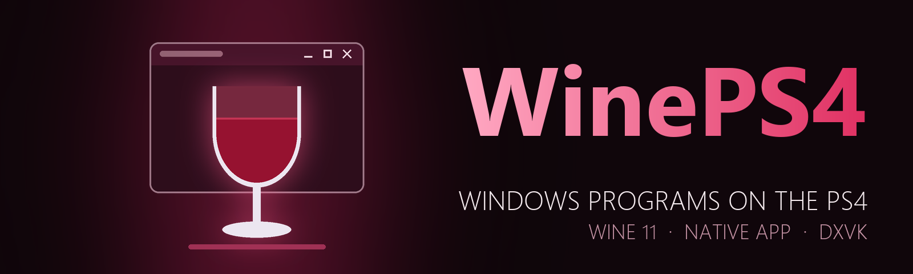

  

  
  
  
  

<h3 align="center">Windows programs on the PS4.</h3>

  <a href="https://github.com/iHaiDeeZ/WinePS4/releases/latest"><b>⬇ Get the latest release</b></a> ·
  <a href="#getting-started">Getting started</a> ·
  <a href="#controls">Controls</a> ·
  <a href="#the-desktop">The desktop</a> ·
  <a href="#settings">Settings</a> ·
  <a href="#faq">FAQ</a> ·
  <a href="CREDITS.md">Credits</a>

---

## Overview

WinePS4 brings [Wine](https://www.winehq.org) 11 to jailbroken PS4 consoles as a native app: no Linux, no virtual
machine. Windows programs run on the PS4's own CPU, their windows are drawn by WinePS4's desktop, and their
Direct3D goes through [DXVK](https://github.com/doitsujin/dxvk) to Vulkan on Mesa's RADV driver, ported to the PS4's
GPU.

It installs as an app on the home screen and opens on a desktop of its own: windows, a taskbar, a Start menu and
your files. Steam signs in and downloads games there, and DRM-free PC games run from your files.

WinePS4 is early work. Steam and some games run, many programs don't yet, and the PS4's limits show: an app gets
seven processes and about 1 GiB of memory for all of them (see [Good to know](#good-to-know)).

You bring your own programs: no Windows files, programs or games are in this repository or its releases. Wine's own
DLLs stand in for Windows'.

## Highlights

**Wine on the PS4**
- Wine 11.0 itself, with the PS4 changes in one patch: 64-bit programs, and 32-bit ones through WoW64 (large
  address aware by default, as under Proton).
- Windows' services and helpers start outside the PS4's seven processes for the app, which stay for programs and
  games.
- Sound from every program, mixed into the PS4's audio out, and the network, with Mozilla's root certificates.

**Games**
- Direct3D 8, 9, 10 and 11 through DXVK 3.1.1, on Vulkan through Mesa's RADV on the PS4's GPU. Iron Snout runs at
  60 fps.
- A full-screen game covers the taskbar. The display is 1920 x 1080 at 60 Hz.

**Steam**
- Start > Steam installs it from its own installer, then starts it. It signs in, and its store and library open in
  its own windows, where games download and install.
- Its web views run in one process, at a lower priority than games, and its helpers that only take processes are
  left out.

**A desktop made for the PS4**
- Windows 11's look, drawn by WinePS4 (no Microsoft artwork): a taskbar, the Start menu, desktop icons and shortcuts,
  and windows you move, resize and maximize.
- Files: the console's storage, USB drives and the C: drive, with copy, move, rename, search, a Recycle Bin and
  properties. Programs and installers (`.exe`, `.msi`, `.bat`) run from there.
- Notepad, a hex editor, a Terminal with every program's output, and Task Manager.
- Dark and light themes, nine wallpapers of WinePS4's own, or your photo.

**Controls**
- The DualShock 4 is the mouse: the left stick or the touch pad moves the pointer, Cross clicks, Square
  right-clicks, the right stick scrolls.
- The PS4's keyboard opens when you click a text field, Steam's sign-in included, and Triangle types into any
  program.
- A USB keyboard and mouse work as on a PC, with Alt+Tab, the Windows key and Ctrl+Shift+Esc.

**When something goes wrong**
- `wine.log`, a freeze report with where every thread of the app was (`hang.log`), and a trace when a program
  crashes, each with its own switch in Settings > Diagnostics.

## Getting started

**You need:** a jailbroken PS4 with **GoldHEN**, an FTP connection to it, and your own Windows programs. A USB
keyboard helps: without one, programs get the mouse and the text you type on the PS4's keyboard, but no Enter, Esc,
Tab or arrow keys.

1. Download **`WinePS4-vXX.YY.pkg`** from the [releases page](https://github.com/iHaiDeeZ/WinePS4/releases/latest),
   copy it to the PS4 (for example to `/data/pkg` over FTP), install it with GoldHEN's **Package Installer** and
   start **WinePS4** from the home screen.
2. The first start copies Windows' files into `/data/WinePS4/prefix`, which takes about a minute (the Terminal says
   so). A program you start meanwhile starts once Windows is ready.
3. Copy your programs or their installers to the PS4 over FTP, anywhere under `/data` or onto a USB drive. In
   **Files**, find them and open them: Cross twice, or Square and **Run**. Installers install to the C: drive as on
   a PC, and Settings > Apps lists what's installed.
4. **Steam:** download `SteamSetup.exe` from [store.steampowered.com](https://store.steampowered.com) on a PC, copy it
   to **`/data/WinePS4/SteamSetup.exe`**, then open **Start > Steam**. Once Steam is installed, the same pin starts
   it. Click a field to sign in with the PS4's keyboard, or use a USB keyboard.

> **Tip:** right-click a program (Square) in Files, or its button on the taskbar, and choose **Create shortcut on
> the desktop** to keep it on the desktop. Steam's game shortcuts (`.url`) work there too.

**Updating WinePS4:** install the newer package on top of the old one. Your C: drive, programs and settings stay
in `/data/WinePS4`.

**Closing WinePS4:** **Start > Power > Exit to the PS4 menu**. It ends every program first.

## Controls

### DualShock 4

| Button | On the desktop | Over a program's window |
|---|---|---|
| Left stick, touch pad | Move the pointer | Move the pointer |
| Cross, R2 | Click (twice to open) | Left mouse button |
| Square | The right-click menu | Right mouse button |
| Right stick | Scroll | Mouse wheel |
| Triangle | The next desktop window to the front | **The PS4's keyboard: type into the program** |
| R1 / L1 | The next / previous desktop window to the front | The same |
| Circle | Back: closes a dialog, a menu or Start; in Files, up a folder | Nothing |
| D-pad | Steps through a menu's items or a dialog's buttons; the arrow keys in Files, Notepad and the hex editor; scrolls elsewhere | Nothing |
| OPTIONS | The Start menu | The Start menu |
| PS button | The PS4's home screen | The PS4's home screen |

Programs' windows are switched with their taskbar buttons (or Alt+Tab on a keyboard). The touch pad moves the
pointer like a laptop's, but doesn't click.

**The PS4's keyboard** opens by itself when you click a text field in a program (a Windows text box, or a field in
Steam's window) or in Notepad, while no USB keyboard is connected (Settings > Bluetooth & devices can turn that
off). Password fields hide what you type. The text goes to the program when you choose Done.

Games don't get a controller yet: the DualShock 4 is the desktop's mouse.

### Keyboard and mouse

Keys go to the program with the focus, as on a PC, unless a desktop window, a menu or Start is in front.

| Keys | |
|---|---|
| Alt+Tab, Alt+Shift+Tab | The next / previous program window |
| Windows key | The Start menu |
| Win+E | A new Files window |
| Win+D | Minimize the desktop's own windows |
| Ctrl+Shift+Esc | Task Manager |
| Alt+F4 | Close the desktop window in front |

In **Files**: Enter opens, Backspace or Alt+Left goes back, Alt+Up goes up, F2 renames, F5 refreshes, Delete moves
to the Recycle Bin, Shift+Delete deletes for good (after asking), Ctrl+C / X / V copy, cut and paste, Ctrl+A selects
all, Ctrl+L types a path, Ctrl+F searches, Ctrl+Shift+N makes a folder. **Notepad** saves with Ctrl+S.

Mice work too: left click, right click and the wheel. Settings > Bluetooth & devices > **Mouse pointer speed** sets
the mouse's speed.

## The desktop

| Where | What's there |
|---|---|
| Taskbar | Start, Search (opens Start), Files, Terminal and Settings, then the editors and programs you have open. A program's button brings its window to the front, or minimizes it when it's in front; Square on it gives **Close window**, **Paste text** (types the desktop's copied text into it), **Create shortcut on the desktop**, **End task** and **Task Manager**. The corner shows the keyboard, mouse and controller, and the clock. |
| Start | Pinned: Files, Terminal, Settings, Task Manager, C: drive, Steam and three test programs. Your recent programs below. **Power**: **Restart WinePS4** or **Exit to the PS4 menu**, both after ending every program. |
| The desktop | This PS4, Recycle Bin, C: drive and Terminal, then what's in `C:\users\ps4\Desktop`, shortcuts included. |
| Files | The places on the left: This PS4, Quick access (Desktop, Downloads, Documents, Pictures, Music, Videos), the Recycle Bin, Local Disk (C:), the whole PS4 (`/`), USB drives 1 to 8, Data (`/data`) and the PS4's own folders. Drag and drop moves on the same drive and copies to another (Ctrl copies, Shift moves). Square on a file: Run or Open, Edit in Notepad, Open in Hex editor, Set as desktop background, Create shortcut on the desktop, Cut, Copy, Rename, Delete, Delete for good, Properties. |
| Terminal | The output of every program (the last 4000 lines). It opens by itself for console programs and `.bat` files. It has no command line. |
| Task Manager | **Processes**: each program's CPU and memory, which run outside the PS4's seven, and End task. **Performance**: CPU and memory over 60 seconds, and how many of the seven processes are in use. |
| Notepad, hex editor | Text files open in Notepad (Find, Undo, Windows or Unix line ends), others in the hex editor, which overwrites bytes but never inserts them. |

A program's window gets a Windows 11 title bar with minimize, maximize and close. Close asks the program to close;
**End task** ends it at once. Pictures can be set as the desktop's background from Files; there's no picture viewer
or media player.

## Settings

| Page | What's in it |
|---|---|
| System | The console, the memory for Windows programs, the storage left on `/data`, the display and the credits |
| Bluetooth & devices | **Mouse pointer speed** (1 to 20, 10 at first) and **Open the PS4's keyboard for a text field clicked** (on) |
| Personalization | **Theme** (Dark or Light) and **Background**: a picture (WinePS4's own, or your photo) or a solid colour |
| Apps | Four switches for programs, then **Installed apps**, each with its Uninstall button |
| Diagnostics | Logs and reports, each with its own switch |

**Apps** (all on at first):

- **Chromium programs in one process**: Steam's, Chrome's, Edge's and Discord's windows each in one process, as the
  PS4 runs seven for the app.
- **Leave out helpers that only take processes**: Steam's start-up probes, install scripts, overlay window, error
  reporter and hardware updater.
- **More than 7 processes (test)**: Windows' services and helpers run outside the PS4's seven, which stay for
  programs and games.
- **3D games on the PS4's GPU (DXVK)**: Direct3D 8 to 11 through DXVK and Vulkan. Off, Wine's own Direct3D draws
  without the GPU.

**Diagnostics:**

| Switch | At first | What it does |
|---|---|---|
| Freeze report | On | When the desktop stands still for 6 s: where each thread of the app is, the kernel's view too, in `hang.log` |
| Crash trace | On | A program that crashes ends at once, with where it crashed in `wine.log`. Off: Wine's debugger comes up, which takes two more of the seven processes |
| Memory guard | On | When the memory programs share is nearly gone, ends a launcher's web window (Steam's) before the app stands still |
| Budget log | On | The PS4's budget for the app (open files, threads, memory) in `wine.log` |
| Performance log | On | Every 10 s: each process's share of the CPU, the desktop's drawing time, free memory |
| Audio log, Vulkan log, Socket option log, Keyboard log | On | Programs' sound streams, swapchains and frames, refused socket options, and how keyboard presses arrive (never which keys) |
| Hang report | Off | Where Wine is stuck, in `hang.log`, once a program has run for 20 s |
| Wine debug messages | Off | Exceptions and DLL loading in `wine.log` |
| Memory log | Off | Every mapping of WinePS4's memory layer (slow) |
| Direct shared memory | Off | A test: programs' shared memory in the PS4's direct memory |

The switches are saved in `/data/WinePS4/env.txt`. Restart WinePS4 (**Start > Power > Restart WinePS4**) for a change
to take effect.

## Your files

Everything lives in **`/data/WinePS4/`**:

- `prefix/`: Wine's prefix. `prefix/drive_c` is the C: drive, and `C:\users\ps4` is your Windows user folder
  (Desktop, Documents, Downloads, ...). Z: is the whole console.
- `SteamSetup.exe`: Steam's installer, when you put it there.
- `run.txt`: a program to start every time WinePS4 starts, one argument per line (lines starting with `#` are
  skipped).
- `env.txt`: the Settings switches, and any environment variable as `NAME=value`.
- `desktop.ini`, `recent.txt`: the theme, background and pointer speed, and your recent programs.
- `Recycle Bin/`: what you deleted from `/data`.
- `shadercache/`: Vulkan's shaders, made again when missing.
- `ca-certificates.crt` (optional): your own list of root certificates, used instead of the package's.
- `wine.log` (written again at every start), `hang.log`, `crash.log`, `boot-trace.log`: logs for bug reports.

## FAQ

**Which programs work?**
Steam (signing in, its store and library, downloading games) and Iron Snout (32-bit, Direct3D 11, 60 fps) have run
on the console. Many programs don't run yet: see [Good to know](#good-to-know) for what's missing. Reports of what
runs and what doesn't are welcome.

**Can I play games with the controller?**
Not yet. The DualShock 4 is the desktop's mouse, and games don't see an XInput controller. A USB keyboard types into
games, and the pointer clicks in them.

**Is this Windows?**
No. Wine runs Windows programs with its own versions of Windows' DLLs, so no Windows licence or Windows files are
needed, and some programs that need Windows itself won't run.

**Why does it say "The PS4 runs 7 Windows processes at once at most"?**
The PS4 gives an app seven processes. WinePS4 starts Windows' background programs outside them and runs each
Chromium program in one process, but when seven programs run, close one before starting another.

**WinePS4 froze.**
Close it from the PS4's home screen, then [open an issue](https://github.com/iHaiDeeZ/WinePS4/issues) with
`wine.log` and `hang.log` from `/data/WinePS4/`, the WinePS4 version, what you were running, and your PS4 model and
firmware. Never attach game files.

**Does it run on a PS4 Pro?**
It hasn't been tried on one. The package asks a Pro for its own mode and faster CPU, but WinePS4's GPU driver is
set up for the base PS4's GPU, so games' 3D may not draw right there. Reports are welcome.

## Good to know

- **Processes:** the PS4 runs seven processes for an app. Windows' services and helpers start outside them, and so
  does a program started while seven run, when there's room for it.
- **Memory:** the programs' processes share about 1 GiB of the PS4's memory. Steam's web views take much of it.
  When it's nearly gone, the Memory guard ends Steam's web window instead of letting the app stand still; Steam may
  then need starting again.
- **CPU:** seven 1.6 GHz Jaguar cores, without AVX2. Launchers' web pages are drawn on the CPU, so they're slow.
  WinePS4 runs wineserver and the desktop ahead of programs, and launchers' web helpers behind games.
- **Graphics:** one display mode, 1920 x 1080 at 60 Hz, and one program at a time on the GPU.
- **Not there yet:** the controller in games, video playback, OpenGL, Direct3D 12, .NET programs (no Wine Mono),
  web pages inside programs (no Wine Gecko), the Steam overlay, a clipboard shared with programs (**Paste text**
  types the desktop's text instead), programs' own mouse cursors, and microphones.
- How the port works, and what changed in each version: **[NOTES.md](NOTES.md)**. Building it:
  **[docs/BUILDING.md](docs/BUILDING.md)** (it needs ps4-kit, the PS4 base of these ports, which isn't published
  yet).

## Thanks

- **[Wine](https://www.winehq.org)** and its developers: everything that runs the programs
- **[DXVK](https://github.com/doitsujin/dxvk)**: Direct3D on Vulkan
- **[Mesa](https://mesa3d.org)**: the RADV Vulkan driver that draws the games
- **[Proton](https://github.com/ValveSoftware/Proton)**: the defaults WinePS4 follows in places
- **[FreeType](https://freetype.org)**, **[FFmpeg](https://ffmpeg.org)** and **[stb](https://github.com/nothings/stb)**:
  fonts and pictures
- **[OpenOrbis](https://github.com/OpenOrbis)** and **[PacBrew](https://github.com/PacBrew)**: the PS4 toolchains
- **[GoldHEN](https://github.com/GoldHEN/GoldHEN)**: the homebrew enabler WinePS4 runs under

Everyone involved, with licences, is listed in **[CREDITS.md](CREDITS.md)**.

## License and disclaimer

Released under the **GNU Lesser General Public License v2.1 or later**, as Wine. See [LICENSE](LICENSE). The
pieces it carries keep their own licences, listed in [CREDITS.md](CREDITS.md). WinePS4 is made by
**iHaiDeeZ / ShiroKlein**.

This is a fan-made project with no ties to Sony Interactive Entertainment, Microsoft, Valve or the Wine project.
PlayStation and PS4 are trademarks of Sony Interactive Entertainment, Windows is a trademark of Microsoft, and
Steam is a trademark of Valve. Please only run programs and games you own. This project won't help you find or
share them.
